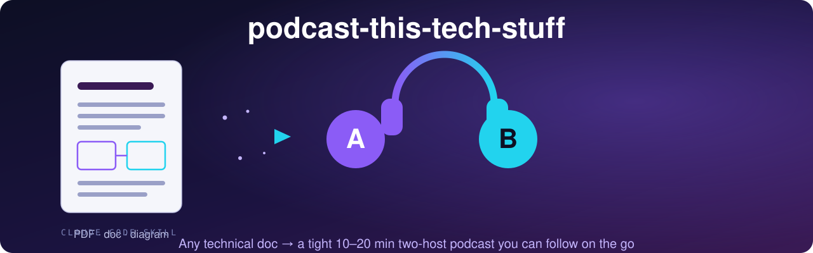

<p align="center">
  
</p>

<p align="center">
  <a href="SKILL.md"></a>
  
  
  
  <a href="LICENSE"></a>
</p>

<h1 align="center">podcast-this-tech-stuff</h1>

<p align="center">
  <b>Feed it a dense spec, PRD, paper, or diagram.<br>
  Get back a tight 10–20 min two-host podcast you can actually follow on the commute.</b>
</p>

---

## Why

Technical docs don't fit into a walk, a drive, or a workout. Reading-aloud tools
are robotic and lecture-y. This skill turns **any** technical source into a
fast-paced, two-host conversation — calibrated to *your* background — so you go
from "I should read that" to "I get what's going on" without sitting at a screen.

- 📄 **Any source** — PDF, slide/diagram PNGs, plain text, or a Google Doc. Mix several into one episode.
- 🎚️ **Calibrated to the listener** — a few quick questions tune the depth, pace, and length.
- 🗣️ **Two-host, not read-aloud** — a curious host + an expert, key terms briefly defined then onward.
- 🎧 **High-quality voices** — Google NotebookLM, driven automatically in your own Chrome.
- 🛟 **Works offline** — local macOS `say` fallback when NotebookLM is unreachable.
- 📁 **Just appears** — finished `.m4a` lands in `~/doc2podcast/episodes/` and opens in Finder.

## How it works

```
source doc(s)  ─►  3 quick questions  ─►  tailored brief  ─►  NotebookLM  ─►  episode.m4a
                                                              (offline ▸ local say fallback)
```

1. **Collect** the source(s) — path, link, or pasted text. Multiple sources are encouraged; they make a richer episode.
2. **Calibrate** — one prompt: how technical is the listener, how long, any extra sources or focus angle.
3. **Brief** — the answers fill a brief that steers generation.
4. **Generate** — NotebookLM produces the episode; the skill polls in the background and pings you when it's done (~5–20 min).
5. **File it** — slugified `.m4a` in `~/doc2podcast/episodes/`, revealed in Finder with its duration.

## Requirements

| Requirement | Why |
|---|---|
| [Claude Code](https://claude.com/claude-code) | Runs the skill. |
| macOS | Offline fallback uses built-in `say` voices and `afinfo`. |
| Google Chrome + NotebookLM access | Primary high-quality path; the skill drives NotebookLM in your own Chrome. Hits a login wall → it stops and asks, never types credentials. |
| `browser-harness` on `$PATH` | CDP browser-control helper used to drive NotebookLM. (Author's setup is a private local tool — swap in your own browser automation if you don't have it; the offline fallback needs none of this.) |
| Python 3 | Offline `say` pipeline. |

## Install

```bash
git clone git@github.com:yotam-the-wiz/Podcast-this-tech-stuff.git \
  ~/.claude/skills/podcast-this-tech-stuff
```

Claude Code discovers the skill from [`SKILL.md`](SKILL.md) automatically — no
registration step. The skill directory **must** be named
`podcast-this-tech-stuff` (it's referenced by the fallback script path).

## Usage

Just ask Claude Code in natural language, with a doc attached or a path/link:

> "podcast this" · "turn this RFC into audio for my commute" ·
> "make this design doc digestible for a non-technical person"

It asks the calibration questions, generates, and notifies you when the episode
is ready — no waiting around.

## Repo layout

| Path | Purpose |
|---|---|
| [`SKILL.md`](SKILL.md) | **The skill** — workflow, calibration questions, style defaults. The file Claude Code loads. |
| [`REFERENCE.md`](REFERENCE.md) | Field-tested playbook for driving NotebookLM via browser-harness (selectors, gotchas). |
| `scripts/poll_notebooklm.sh` | Background poller that waits out NotebookLM generation. |
| `scripts/local_fallback.py` | Offline two-host `say` pipeline (voices A/B, stitch, write `.m4a`). |
| `assets/banner.svg` | Repo banner. |

## License

[MIT](LICENSE) © 2026 Yotam Reis
